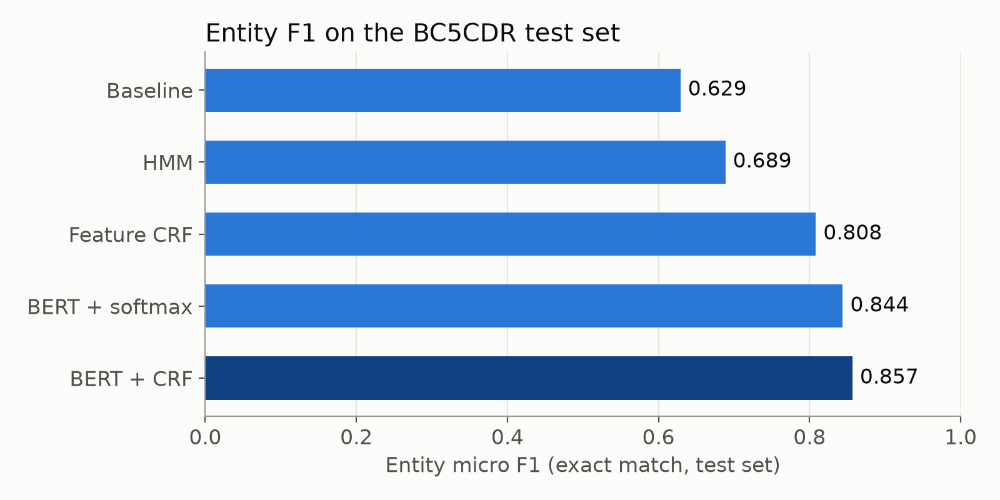
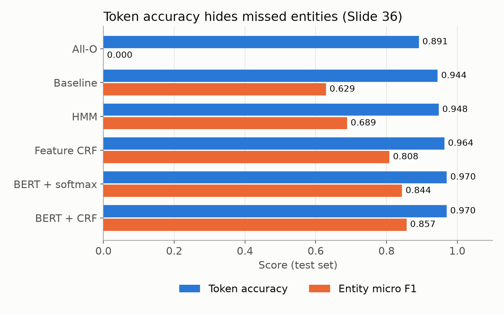
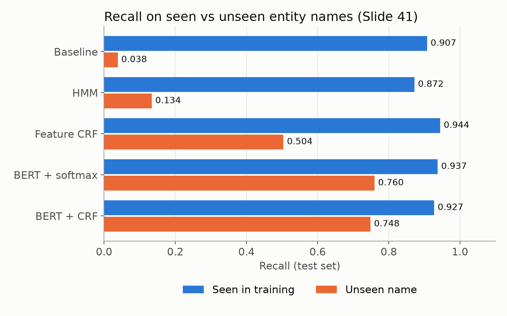
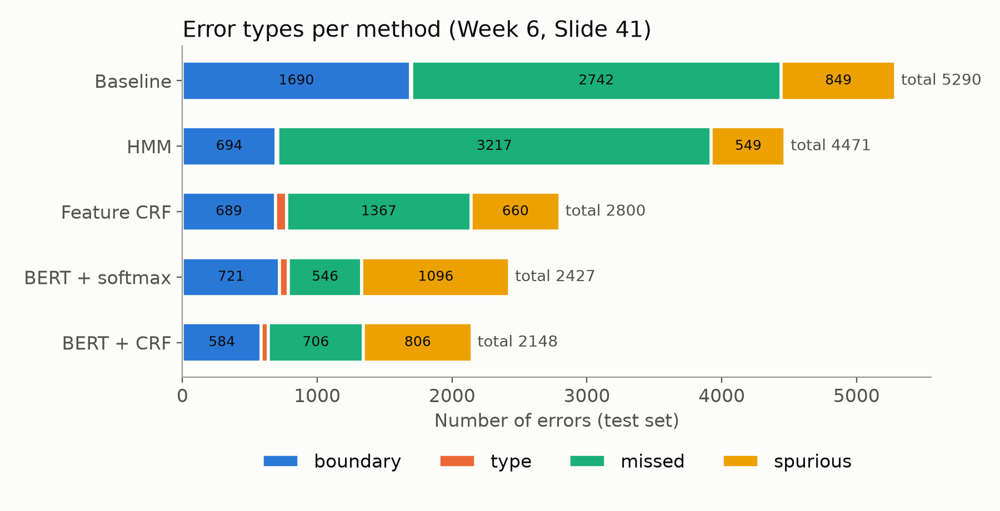
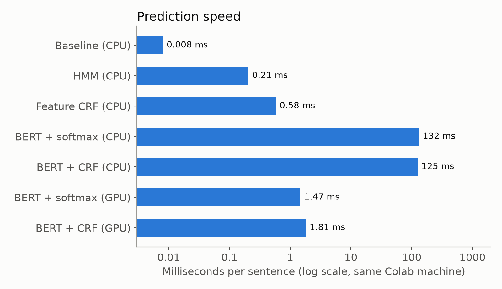
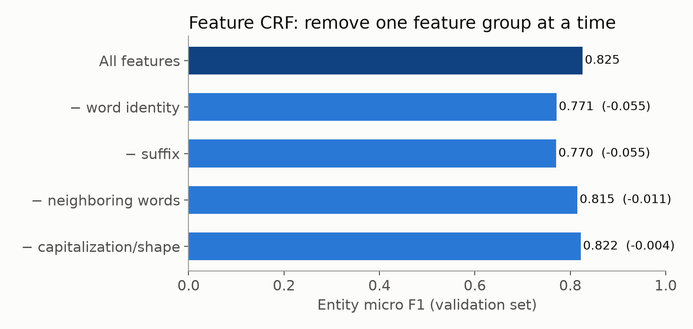

# Biomedical Named Entity Recognition on BC5CDR

**COE025 Natural Language Processing, Project 2 (Istinye University, Fall 2026)**

We find **chemical** and **disease** names in medical text. This is Named Entity Recognition (NER), a token classification task. We compare five methods, from a simple baseline to BERT + CRF, using the same data split and the same metric.

> Everything in this project follows the course slides. `SLIDE_MAP.md` links every file and function to its slide.

## 1. Problem

Week 1, Slide 31 (Project 2): NER for information extraction, with medical records as a real-world use case.

Example from the BC5CDR training data, with BIO labels (Week 6, Slide 23):

| Naloxone | reverses | the | antihypertensive | effect | of | clonidine | . |
|---|---|---|---|---|---|---|---|
| B-Chemical | O | O | O | O | O | B-Chemical | O |

- **B-X** = the first word of an entity of type X
- **I-X** = a later word of the same entity
- **O** = outside any entity

## 2. Dataset: BC5CDR (`tner/bc5cdr`, Hugging Face)

We read all of the following from the data itself (`python -m data.inspect_data` → `results/data_inspection.json`, following Week 6, Slide 32).

| | Train | Validation | Test |
|---|---|---|---|
| Sentences | 5,228 | 5,330 | 5,865 |
| Tokens | 109,322 | 108,958 | 116,318 |
| Chemical entities | 5,203 | 5,347 | 5,385 |
| Disease entities | 4,182 | 4,244 | 4,424 |

- **Label map (`id2label`)**: `{0: O, 1: B-Chemical, 2: B-Disease, 3: I-Disease, 4: I-Chemical}`. This is saved with every model (Slide 40).
- **Scheme**: IOB2. We checked: 0 invalid transitions in the gold labels of all three splits.
- **`O` share**: 89.1% of the test tokens are `O`. This is why token accuracy is misleading (Slide 36).
- **Overlap audit** (Slide 41): there are no long sentences shared between train and test. The only shared sentences are short pieces such as "A case report .".
- **Unseen names**: 38% of the test entities never appear as an entity in training.
- **BERT length**: the longest sentence has 326 subwords, which is under the 512 limit, so no sentence is truncated (Slide 40).
- **License**: see the dataset card. The data is downloaded by the code and is not stored in this repository.

## 3. Methods (simple → strong)

| # | Method | What it adds | Code | Slides (Week 6) |
|---|---|---|---|---|
| 1 | Frequent-tag baseline | Each word gets its most frequent training label; unknown word → `O`; no context | `src/baseline.py` | 11 |
| 2 | HMM + Viterbi | Label transitions; best whole path with Viterbi; add-α smoothing, `UNK`, log space | `src/hmm.py`, `src/viterbi.py` | 49–66 |
| 3 | Feature CRF (PyTorch) | Rich features (word, capitalization/shape, suffix, neighbors); forward algorithm with log-sum-exp; hard IOB2 mask | `src/crf.py` | 67–81 |
| 4 | BERT + softmax | Contextual vectors from `bert-base-cased`; one softmax per word; first-subword alignment with −100 | `src/bert_softmax.py`, `src/bert_common.py` | 33–35, 82–86 |
| 5 | BERT + CRF | BERT scores as CRF unary scores + the same IOB2 mask | `src/bert_crf.py` | 79–82 |

**Protocol** (Week 6, Slide 41; Week 3 lecture notes):
- All methods use the same train / validation / test split.
- All settings were chosen on **validation only**:
  - baseline: lowercase
  - HMM: lowercase, emission α = 0.1, words seen once → `UNK`
  - CRF: L2 = 1e-6 and the best epoch
  - BERT: the best epoch
- The **test set was used once**, at the end (`src/final_eval.py`).
- Vocabularies, counts and features come from the training data only (Slide 11).
- Random seeds are fixed (42).

## 4. Results (test set, used once)

From `results/results_table.md` and `results/test_results.json`.

| Method | Micro P | Micro R | **Micro F1** | Macro F1 | Chemical F1 | Disease F1 | Token acc. | Invalid IOB2 | ms/sentence CPU | ms/sentence GPU |
|---|---|---|---|---|---|---|---|---|---|---|
| All-O (Slide 36 demo) | 0.000 | 0.000 | **0.000** | 0.000 | 0.000 | 0.000 | 0.891 | 0 | – | – |
| 1. Frequent-tag baseline | 0.690 | 0.578 | **0.629** | 0.630 | 0.730 | 0.529 | 0.944 | 1265 | 0.008 | – |
| 2. HMM + Viterbi | 0.822 | 0.592 | **0.689** | 0.688 | 0.717 | 0.659 | 0.948 | 0 | 0.21 | – |
| 3. Feature CRF | 0.842 | 0.777 | **0.808** | 0.804 | 0.855 | 0.752 | 0.964 | 0 | 0.58 | – |
| 4. BERT + softmax | 0.819 | 0.870 | **0.844** | 0.838 | 0.901 | 0.775 | 0.970 | 342 | 132 | 1.47 |
| 5. BERT + CRF | 0.854 | 0.859 | **0.857** | 0.852 | 0.903 | 0.801 | 0.970 | 0 | 125 | 1.81 |

- **Metric**: entity-level exact match (Week 6, Slides 37–39). A predicted entity counts only if its start, its end and its type are all correct.
  - F1 = 2TP / (2TP + FP + FN)
  - **Micro F1** pools the counts of both types; **macro F1** is the plain average of the Chemical F1 and the Disease F1.
  - `O` is not an entity type.
  - **Zero-division rule**: if a denominator is 0, the score is 0.
  - The metric is written by us and unit-tested on the slide examples (`tests/test_metrics.py`).
- **Invalid IOB2**: the number of illegal label transitions in the predictions, for example `O → I-Disease` (Slides 23, 80).
- **Speed**: prediction time per sentence on the validation split (5,330 sentences; BERT on CPU: 500 sentences). All methods ran on the **same Google Colab machine**: Tesla T4 GPU, 2 vCPUs, PyTorch 2.11 using 1 CPU thread (`results/timing/timing_colab.json`). The classical methods were also timed on a laptop (Intel i5-1135G7, Windows 11): `results/timing/timing_laptop.json`.

Validation micro F1 (used for choices): baseline 0.642, HMM 0.706, feature CRF 0.825, BERT + softmax 0.854, BERT + CRF 0.873.

**Benchmarks.** The course slides contain no published BC5CDR results, so we do not quote outside numbers. Our reference point is method 1 (the baseline). Week 6, Slide 41: "A score is evidence under a specific dataset and protocol."

### Figures (`results/figures/`)
| | |
|---|---|
|  |  |
|  |  |
|  |  |

## 5. Feature engineering: CRF ablation (validation)

We removed one feature group at a time (`results/validation/crf_ablation.json`):

| Features | Micro F1 | Change |
|---|---|---|
| All features | 0.825 | – |
| − word identity | 0.771 | −0.055 |
| − suffix | 0.770 | −0.055 |
| − neighboring words | 0.815 | −0.011 |
| − capitalization / word shape | 0.822 | −0.004 |

Suffixes matter as much as the word itself. Drug and disease names share endings ("-zole", "-itis", "-emia"), and this helps with names never seen in training.

## 6. Error analysis (summary; full report: `results/ERROR_ANALYSIS.md`)

1. **Accuracy hides missed entities** (Slide 36). The all-O model gets 89.1% token accuracy and 0 entity F1. BERT + softmax has slightly *higher* token accuracy than BERT + CRF (0.9704 vs 0.9700) but *lower* entity F1 (0.844 vs 0.857).
2. **Unseen names** (Slide 41) show the biggest difference. Recall on unseen names: baseline 0.038, HMM 0.134, feature CRF 0.504, BERT + softmax 0.760, BERT + CRF 0.748. On seen names, all methods are between 0.87 and 0.94.
3. **Structured decoding** (Slide 87):
   - BERT + softmax makes 342 invalid transitions; the CRF models make 0 because of the hard mask.
   - On the 294 sentences where softmax was invalid, BERT + CRF raises F1 from 0.680 to 0.769.
   - But BERT + CRF misses more entities in total (706 vs 546). It is "an option, not a universal upgrade" (Slide 82).
4. **Error types** (Slide 41): type errors are rare. Most errors are missed entities, extra (spurious) entities and boundary errors, mainly for multi-word **Disease** names.
5. **Annotation ambiguity**: in training, "acute" is labeled `O` 99 times and `B-Disease` 52 times, so every method misses [acute nephrotoxicity].

## 7. How to run

**Local (methods 1–3, evaluation, figures). Python 3.11, CPU is enough:**
```bash
pip install -r requirements.txt
python -m pytest -q tests          # 23 tests: the metric and the algorithms reproduce the slide examples
python -m data.inspect_data        # dataset report -> results/data_inspection.json
python -m src.baseline             # method 1 (validation)
python -m src.hmm                  # method 2 (validation grid)
python -m src.crf                  # method 3 + feature ablation (about 15 min on a laptop CPU)
```

**Google Colab (methods 4–5, needs a GPU):**
1. `python notebooks/make_colab_upload.py` makes `colab_upload.zip` (code + models 1–3).
2. Open `notebooks/colab_bert.ipynb` in Colab and choose **Runtime → Change runtime type → T4 GPU**.
3. Run all cells. Upload the zip when the notebook asks for it, and download `results_colab.zip` at the end.
4. Unzip `results_colab.zip` into the project folder (it fills `results/`).

**Final evaluation (once, at the end):**
```bash
python -m src.final_eval           # test-set scores -> results/test_results.json, results/results_table.md
python -m src.error_analysis       # -> results/error_analysis_test.json, results/error_examples_test.md
python -m src.figures              # -> results/figures/*.png
```

**Slides** (every number is read from `results/`):
```bash
npm install pptxgenjs@3.12.0
node presentation/make_slides.js   # -> presentation/project2.pptx
```

## 8. Repository structure
```
README.md            problem, data, methods, results, how to run
SLIDE_MAP.md         every file/function -> the slide it comes from
requirements.txt
data/                bc5cdr.py (loading), inspect_data.py (inspection)
src/                 baseline, hmm, viterbi, crf, bert_common, bert_softmax, bert_crf,
                     metrics, bio, final_eval, error_analysis, timing, figures, utils
tests/               test_metrics.py, test_hmm.py, test_crf.py
notebooks/           colab_bert.ipynb (+ the two small scripts that make it and the upload zip)
results/             metrics JSON, tables, figures, error analysis, logs
presentation/        project2.pptx, make_slides.js
```

## 9. Team
| Member | Student number |
|---|---|
| Çınar Sabancı | 2409115637 |
| Bashir Alzoubi | 2409115364 |
| Nader Ochen | 2309116429 |

## 10. References
- Course slides: COE025 Weeks 1, 2, 3 and 6 (method details: Week 6 study deck).
- Dataset: BC5CDR, `tner/bc5cdr` on Hugging Face. Wei et al. (2016), *Database*, "Assessing the state of the art in biomedical relation extraction: overview of the BioCreative V CDR task".
- Model: `bert-base-cased` (Hugging Face).
